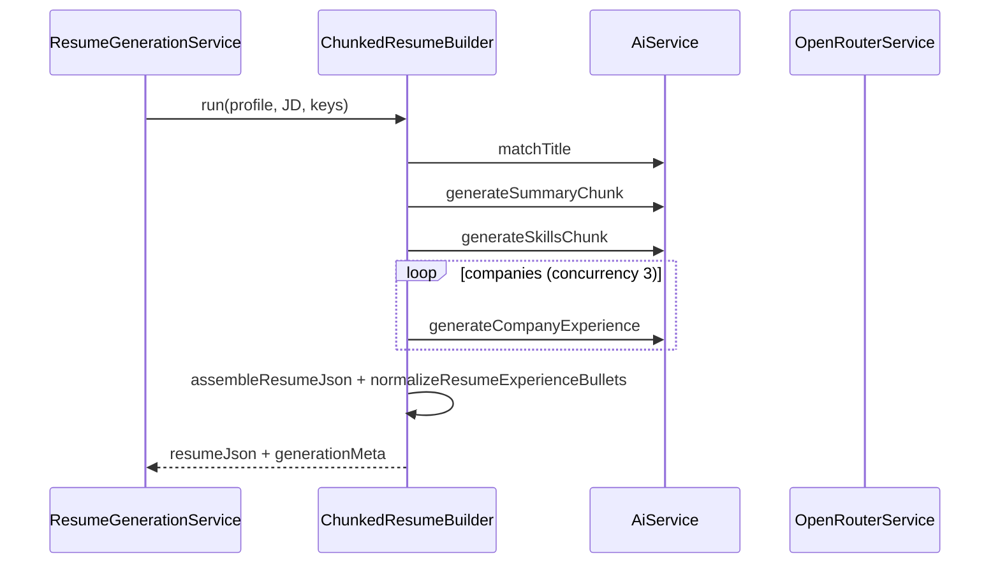

# AI workflow

## Purpose

Call OpenRouter for **chunked** resume generation (title, summary, skills, per-company experience), cover letters, and application Q&A; expose a cached model catalog; assemble profile static data with AI chunks.

## Actors

| Actor | Role |

|-------|------|

| ChunkedResumeBuilder | Orchestrates per-step calls + progress emits |

| AiService | Title/summary/skills/experience chunk methods + cover letter / Q&A |

| OpenRouterService | HTTP chat completions + `createJsonCompletion` |

| OpenRouterModelsService | Catalog + model existence check / fallback |

| PromptRegistryService | Short industry overlay (~1KB), not full industry `.md` in every call |

| UsersService | Candidate profile + decrypted API keys + resume settings |

## Chunked resume steps

| Step | Default model | max_tokens |

|------|---------------|------------|

| Title match | `openai/gpt-4o-mini` | 256 |

| Summary | `anthropic/claude-sonnet-4.6` | 512 |

| Skills | `openai/gpt-4o-mini` | 1024 |

| Experience × N | `openai/gpt-5.4-mini` (fallback `gpt-4o-mini`) | 1024 |

- Title kept if similarity ≥ **0.8** vs professional title; else use inferred `rootTitle`.

- Most recent company `experience.title` equals final root title after assembly.

- Experience runs in parallel with concurrency limit **3**.

- Company experience system prompt: `DEFAULT_COMPANY_EXPERIENCE_PROMPT` + optional `user.experiencePrompt` + mandatory rules + optional industry overlay.

- Product/mission facts are passed in the **user** message, not invented by the model.

## Sequence diagram

## Key files

| Path | Notes |

|------|--------|

| `apps/backend/src/resumes/chunked-resume.builder.ts` | Orchestrator |

| `apps/backend/src/ai/assemble-resume-json.ts` | Merge |

| `apps/backend/src/ai/prepare-company-experience-instructions.ts` | Experience system prompt |

| `apps/backend/src/ai/schemas/*.ts` | Per-step JSON shapes |

| `packages/shared/src/default-prompts.ts` | Summary / skills / experience defaults |

| `packages/shared/src/ai-models.ts` | Per-step model constants |

| `packages/shared/src/candidate-profile.ts` | Completeness validator |

Legacy single-shot `AiService.generateResume` remains for compatibility but standard generate uses the chunked builder.

## Cover letter / Q&A

Unchanged: use assembled `resumeJson` from the completed resume; prompts from profile.

## Error cases

| Case | Behavior |

|------|----------|

| Incomplete profile | BadRequest before any API call |

| Missing model in catalog | Fallback (e.g. experience → gpt-4o-mini) with warning |

| JSON parse failure | One retry with stricter json_object |

| Experience call fails | Propagate with company name |

