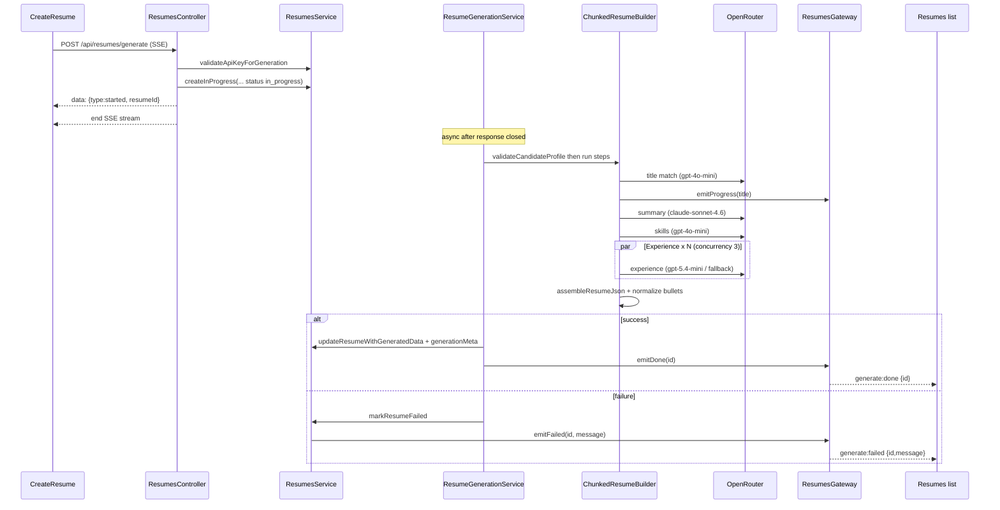
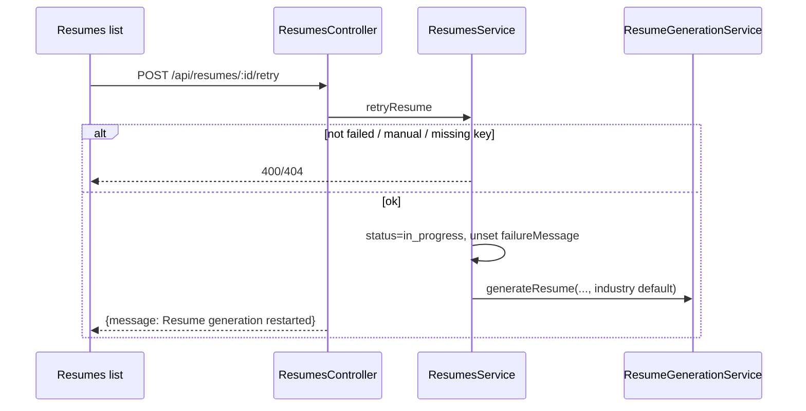

# Resumes workflow


## Purpose


Create and manage tailored resumes: **chunked** async AI generation (SSE kickoff + Socket.IO progress/completion), manual from-JSON PDF creation, retry of failed AI jobs, list filters, application Q&A, downloads, and cover letters. There is **no** generic `POST /api/resumes` create endpoint.


## Actors


| Actor | Role |

|-------|------|

| Authenticated user | Owns resumes scoped by `userId`; stores candidate profile on User |

| ResumesController | HTTP + SSE |

| ResumeGenerationService | Background orchestration entry |

| ChunkedResumeBuilder | Title → summary → skills → experience (parallel) |

| ResumesService | CRUD, filters, download, cover letter orchestration |

| ResumesGateway | Emits `generate:progress` / `generate:done` / `generate:failed` |

| PromptRegistryService | Optional short industry overlay (not full 11KB prompts) |

| AiService / OpenRouter | Per-step model inference |

| Frontend resume list / CreateResume | Listens to sockets; generate page uses SSE |


## Sequence diagrams


### Generate (chunked SSE + background + socket)





### From JSON


```mermaid

sequenceDiagram

  participant UI as CreateResume fromJson

  participant API as ResumesController

  participant Svc as ResumesService


  UI->>API: POST /api/resumes/from-json

  API->>API: strip cover_letter; fix mailto email

  API->>Svc: create(..., status completed, generationSource manual)

  Svc-->>UI: PDF attachment (application/pdf)

```


### Retry failed AI resume





## Key files


| Path | Notes |

|------|--------|

| `apps/backend/src/resumes/chunked-resume.builder.ts` | Multi-step orchestration |

| `apps/backend/src/ai/assemble-resume-json.ts` | Merge profile + AI chunks |

| `apps/backend/src/resumes/resume-generation.service.ts` | Async generation pipeline |

| `apps/backend/src/resumes/resumes.gateway.ts` | Socket.IO emits |

| `apps/frontend/src/pages/resumes/` | List + CreateResume |

| `packages/shared/src/candidate-profile.ts` | Profile types + validator |


## Static vs AI fields


**From profile (never AI-written):** name, primary contact, education, certifications, company shell (name, dates, job_type, product, mission).


**AI-generated:** root title (optional adjust), summary, skills (from baseline), experience achievements/skills per company.


## WebSocket events


| Event | Payload |

|-------|---------|

| `generate:progress` | `{ id, step: title\|summary\|skills\|experience, index?, total? }` |

| `generate:done` | `{ id }` |

| `generate:failed` | `{ id, message? }` |


## Error cases


| Case | Behavior |

|------|----------|

| Incomplete candidate profile | Fail before any OpenRouter call; actionable error list |

| No OpenRouter key | `400` before work starts |

| One experience call fails | Fail whole job with company name in message |

| JSON parse fail on a step | Retry once with stricter JSON; then mark failed |

| from-json path | Unchanged; bypasses chunked builder |


## MongoDB data


**Resume** adds optional `generationMeta: { chunked: true, steps: [...] }`.


**User** stores `contacts[]`, `candidateProfile`, `companies[]`, `experiencePrompt`.


